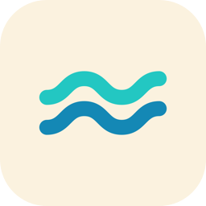
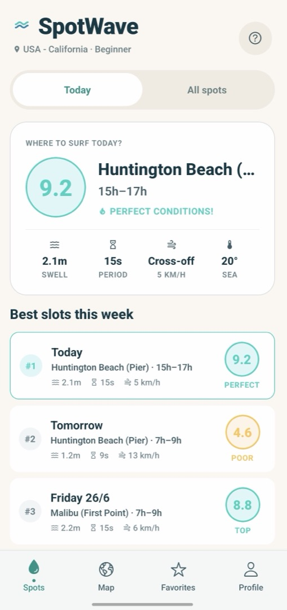
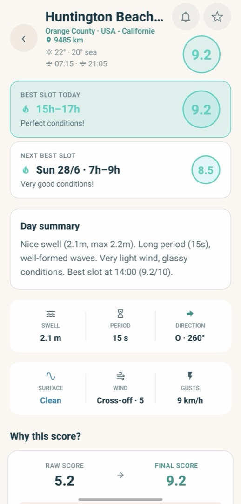
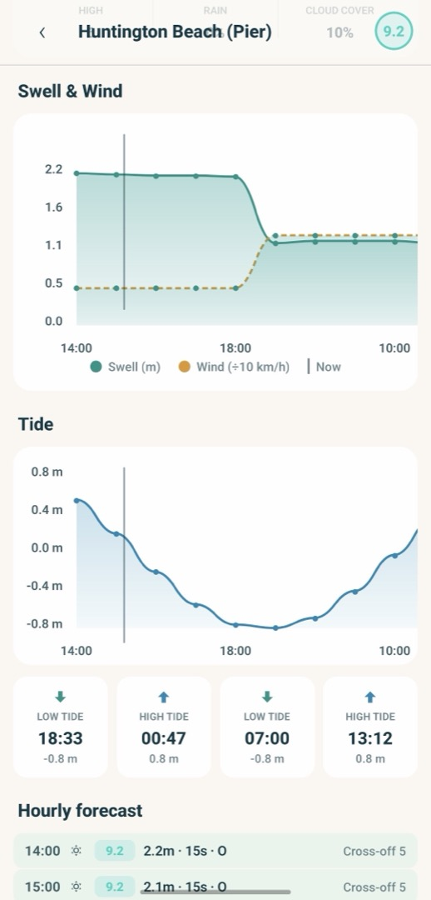
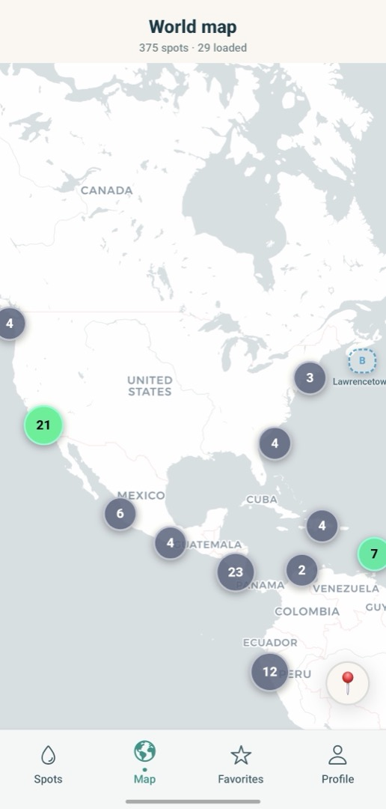

<div align="center">
  
  <h1>SpotWave</h1>
  <p>Surf forecasts boiled down to one score.</p>

  
  
  
  
  
</div>

## Features

- [x] One score from 0 to 10 for every spot, every hour
- [x] Swell, wind, tides, water and air temperature, up to 10 days ahead
- [x] 370+ spots worldwide, on a map that also works offline
- [x] Alerts with your own threshold, spot by spot
- [x] A weekly summary of the best slots on your favorite spots
- [x] Search by spot, region or country
- [x] Suggest a missing spot right from the app
- [x] Dark and light theme
- [x] 7 languages
- [x] Free: no ads, no account, no tracking
- [x] Entirely open source

## Download

[](https://play.google.com/store/apps/details?id=com.spotwave.app)

## Screenshots

<div align="center">
  
  
  
  
</div>

## How the score works

Forecasts come from the [Open-Meteo](https://open-meteo.com) marine and weather APIs. The score lives in [`src/utils/scoring.ts`](src/utils/scoring.ts): swell height and period set the potential, the wind direction relative to the beach (offshore, cross, onshore) and its strength adjust it, and your surfer profile tunes it. Every factor is smooth, so the score doesn't jump from one hour to the next. Tests in [`src/__tests__/`](src/__tests__/) check that well-known sea states land in the same band as the ratings of established surf forecasters.

## Feedback and contributions

***All contributions are very welcome!***

- Bug reports and feature requests go [here](https://github.com/matteogalfre/SpotWave/issues). The forms tell you what to include.
- A spot is missing or wrong? Fix it in [`src/data/spots.ts`](src/data/spots.ts), or suggest it from the app.
- The score feels off on a spot you know? Open an issue with the date, the spot and what the waves were really like.
- Developers: fork the project and open a pull request.

## Translation

SpotWave speaks English, French, Spanish, Portuguese, German, Italian and Japanese. Found a clumsy sentence, or want your language? Each language is one file in [`src/i18n/`](src/i18n/): copy `en.ts`, translate it and open a pull request.

## Run it locally

```bash
npm install
npx expo start      # Android, iOS or web
npm test            # scoring, tides, search and weekly summary tests
npm run build:web   # PWA build in dist/
```

Android release builds go through EAS (`eas.json`). For local signing, copy `credentials.json.example` to `credentials.json` and fill it in: it is git-ignored.

## Privacy

SpotWave collects nothing: no account, no analytics, no ads. Location is optional and stays on your phone. Full policy [here](https://matteogalfre.github.io/SpotWave-page/).

## Credits

Forecast data by [Open-Meteo](https://open-meteo.com), under [CC BY 4.0](https://creativecommons.org/licenses/by/4.0/).

## License

SpotWave is licensed under the [GNU General Public License v3](LICENSE): you can use, study, change and share it, as long as your version stays open too.
